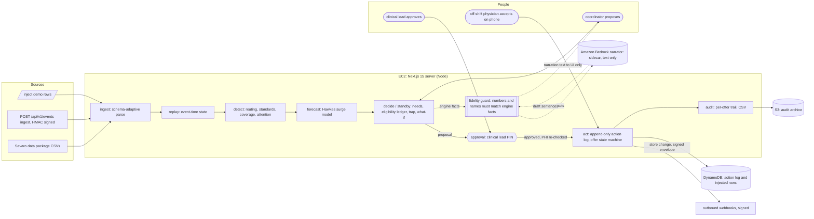

# Architecture

AI narrates. Humans decide. Every action Lookahead takes must be explainable, auditable and reversible, so every decision comes from the deterministic, tested engine (packages/engine) and a named person. A language model only narrates engine-computed facts, behind a deterministic fidelity guard, and has no write path into approval, the action log or Sevaro state.

The live page is `/architecture`: it draws the decision pipeline as hand-written SVG, shows the Mermaid below verbatim, and computes its counters and badges at request time (`GET /api/architecture`).

## Deployment and decision path

The block below is the same text as `ARCHITECTURE_MERMAID` in apps/web/src/server/architecture.ts (a test in apps/web/test/architecture.test.ts checks they are identical).

- **EC2**: one Next.js 15 server (Node runtime) runs the engine in-process; the engine is pure TypeScript and takes `now` as an argument (CLAUDE.md rule 3). See scripts/aws/deploy-ec2.md.
- **Ingest**: the Sevaro CSV package, `POST /api/v1/events` (HMAC-signed when DEMO_MODE is off) and the /inject demo page all go through the same schema-adaptive parser.
- **DynamoDB** (`STORE=dynamo`): the append-only action log and injected rows; the file repo under data/live/ is the default and the fallback.
- **S3** (AUDIT_BUCKET set): before a reset or dataset swap wipes the action log, the audit CSV and the raw log are copied to S3 (apps/web/src/server/archive.ts); best effort, never blocks the reset.
- **Outbound webhooks** (LOOKAHEAD_WEBHOOK_URL set): every store change is POSTed as a small signed envelope with no clinical content; subscribers refetch /api/v1/* (apps/web/src/server/webhooks.ts).
- **Amazon Bedrock**: the narrator sidecar (apps/web/src/server/narrate/). It receives a facts JSON, returns 2-3 sentences, and the fidelity guard checks every number, time and name against the facts plus the PHI denylist and a length cap. Any failure, timeout or missing credentials serves the deterministic template instead.

## Where people decide (brief "Users and Decision Rights")

| Step | Who | Enforced by |
|---|---|---|
| Propose an offer, standby or escalation | coordinator | `COMMAND_ROLES` in packages/engine/src/act/commands.ts, checked server-side before the store |
| Approve or reject (every offer and pre-alert) | clinical lead (PIN cookie) | same; PHI re-check at send time |
| Accept or decline | the off-shift physician (signed offer link) | same |
| Deliveries, 10-minute expiry, gap-filled cancellation | system (materializations only) | the act layer; never a decision |

## Live counters on /architecture

All computed by `architectureCounters(log)` in apps/web/src/server/architecture.ts from the action log alone:

- **Engine recommendations acted on**: proposal-type actions recorded by a person (offer_proposed, standby_proposed, standby_activation_proposed, escalation_raised, reassignment_requested).
- **Decisions made by AI**: decision actions (propose, approve, reject, accept, decline, authorize, release, manual cancel) whose actor role is not coordinator, clinical lead or physician. Deliveries, expiries, superseded offers, gap-filled cancellations and automated internal alerts are excluded as system materializations. Expected 0.
- **Messages sent without human approval**: physician deliveries with no earlier clinical-lead approval of the same offer or standby, plus release messages not issued by a clinical lead. Expected 0.
- **PHI guard checks passed**: message texts recorded in the log; each passed the guard to be recorded (drafting check and send-time re-check).
- **PHI re-check violations now**: every logged text re-run through the denylist at request time. Expected 0.
- **PHI guard blocks**: not logged. A blocked message is refused with PHI_BLOCKED and appends nothing to the append-only log, so the page says "not logged" rather than showing 0.

Badges: the engine-source scan uses the same regex as packages/engine/test/no-hardcode.test.ts and reports the number of files scanned (or "scan unavailable" when packages/engine/src is absent at runtime); the test badge reads docs/test-report.json (`pnpm test:report`) or says there is no report yet.

## Live scale test

`POST /api/scale-test[?scale=N]` (default x20, max x40) runs `scripts/scale-bench.ts --json --quick` in a child process (node with the tsx loader): one run per stage, the composite stages skipped, no docs write, so the live store is never touched. One run at a time (409 otherwise); `SCALE_TEST_TIMEOUT_MS` (default 30000) kills the child and answers 504 naming the stage reached; no tsx loader at runtime answers 503. The page words each stage from its measured value only: "under 1 s" appears only for a stage measured under 1000 ms. `pnpm scale:bench` (3 runs per stage) still writes docs/SCALE.md.
